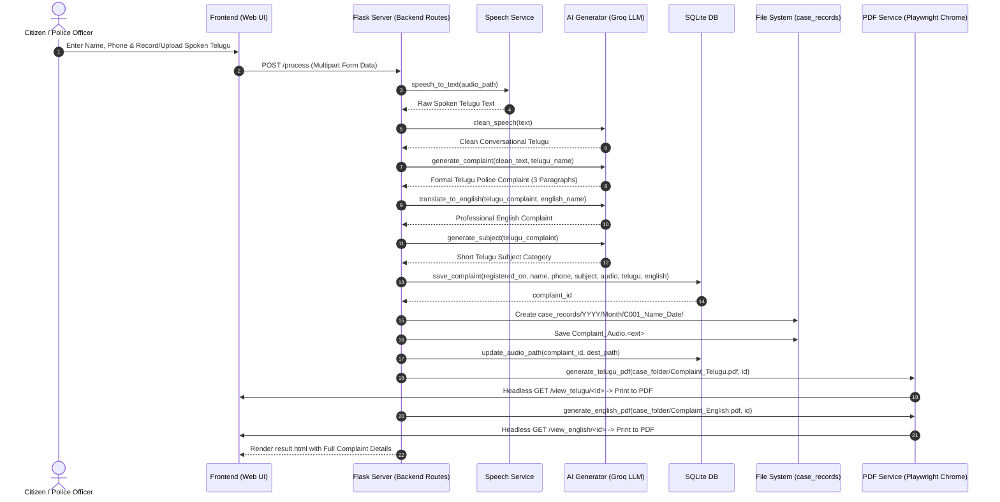

# CSP_V2 Modular Refactoring Plan
**Project:** Voice-Based AI-Assisted Police Complaint Drafting System  
**Target:** Clean Modular Frontend / Backend Architecture  
**Created:** 2026-10-19  

---

## 1. Executive Summary & Current State Audit

The application is an AI-assisted police complaint drafting portal designed for police stations in Andhra Pradesh / Telangana, supporting Telugu and English complaint generation from spoken Telugu or audio uploads.

The system is currently operational on Windows at `http://127.0.0.1:5000/`.

### Verified Working Capabilities
1. **Audio Ingestion:** In-browser live recording via `MediaRecorder` API (WebM) and direct audio file upload (`.wav`, `.mp3`, `.m4a`, etc.).
2. **Speech Recognition:** Transcription using Google Speech Recognition (`te-IN` Telugu locale) via `speech_recognition` and `pydub`.
3. **AI Speech Correction & Drafting:** Groq LLM integration using `openai/gpt-oss-120b` and `openai/gpt-oss-20b` with fallbacks for speech repair, formal police complaint generation, English translation, and automated subject classification.
4. **Official Record Structuring:** Automated case folder hierarchy under `case_records/YYYY/Month/C<ID>_<Name>_<Date>/`.
5. **PDF Generation:** Playwright-based PDF capture configured to use system Google Chrome (`channel="chrome"`).
6. **Persistence:** SQLite (`complaints.db`) containing existing records, complaint text, audio paths, and statistics.
7. **Station Customization:** Station name and locality stored in `station_config.json`.

---

## 2. Inventory of Existing Project Files

| Existing Path | Type | Purpose | Dependencies |
| :--- | :--- | :--- | :--- |
| `app.py` | Python (Flask monolith) | Routes, application wiring, orchestration | All services, templates |
| `ai_generator.py` | Python (AI Service) | Groq client, prompts, LLM fallback loop, output cleaner | `groq`, `python-dotenv` |
| `speech.py` | Python (Speech Service) | Audio conversion & Google Speech transcription | `pydub`, `speech_recognition` |
| `pdf_generator.py` | Python (PDF Service) | Playwright Chromium/Chrome PDF export | `playwright.sync_api` |
| `database.py` | Python (Database Service) | SQLite table init, CRUD queries, statistics | `sqlite3` |
| `station_config.json` | JSON Config | Police station metadata in English and Telugu | File I/O |
| `complaints.db` | SQLite Database | 13 existing complaint records | `sqlite3` |
| `templates/dashboard.html` | Jinja2 HTML | Dashboard, stats cards, complaint table, audio modal | CSS & JS inline |
| `templates/record.html` | Jinja2 HTML | Voice recording, audio upload, complainant details | CSS & JS inline |
| `templates/result.html` | Jinja2 HTML | Telugu complaint preview, print/PDF button | CSS inline |
| `templates/english.html` | Jinja2 HTML | English translated complaint preview | CSS inline |
| `templates/settings.html` | Jinja2 HTML | Police station configuration form | CSS inline |
| `templates/error.html` | Jinja2 HTML | Error display page | CSS inline |
| `fonts/TiroTelugu-Regular.ttf` | Font Asset | Telugu TrueType font | Layout rendering |
| `case_records/` | Directory | Permanent case folder storage for audio and PDFs | Disk storage |
| `audio/` | Directory | Temporary uploads and recorded audio storage | Disk storage |
| `.env` | Secret Environment | Stores `GROQ_API_KEY` | Must remain protected |
| `.gitignore` | Git Exclusion | Ignores `.env`, `venv/`, `*.db`, audio files | Git version control |
| `req.txt` | Requirements | Python package dependencies | Pip |

---

## 3. Route & HTTP Method Catalogue

All existing routes and endpoints must be preserved exactly:

| Route Path | HTTP Methods | Endpoint Name | Template / Response | Controller Purpose |
| :--- | :---: | :--- | :--- | :--- |
| `/` | `GET` | `dashboard` | `dashboard.html` | Displays overall, daily, and monthly case counts with complaint history. |
| `/record` | `GET` | `record` | `record.html` | Provides live mic recorder and audio file upload interface. |
| `/settings` | `GET` | `settings` | `settings.html` | Form for station name, place, and district settings. |
| `/save_settings` | `POST` | `save_settings` | Redirect -> `dashboard` | Translates station values to Telugu and persists to `station_config.json`. |
| `/process` | `POST` | `process` | `result.html` or `error.html` | Core pipeline: ingests audio, transcribes, drafts complaint, translates, saves DB & case files, triggers PDF exports. |
| `/english` | `GET` | `english_page` | `english.html` | Displays the most recently generated English complaint from memory. |
| `/view_telugu/<int:complaint_id>` | `GET` | `view_telugu` | `result.html` | Displays formatted official Telugu complaint for print and PDF generation. |
| `/view_english/<int:complaint_id>` | `GET` | `view_english` | `english.html` | Displays formatted official English complaint for print and PDF generation. |
| `/case_audio/<path:filepath>` | `GET` | `serve_case_audio` | Streamed Audio File | Streams audio file for in-browser playback modal. |

---

## 4. End-to-End Workflow Trace



---

## 5. Frontend-to-Backend Contracts & Dependencies

### Form Parameters in `POST /process`
- `complainant_name` (Text, required)
- `phone_number` (Text, required)
- `audio` (File upload, optional if `recorded_audio` provided)
- `recorded_audio` (Hidden file input, blob recorded via `MediaRecorder`)

### Form Parameters in `POST /save_settings`
- `station_name` (Text, required)
- `place` (Text, required)
- `district` (Text, required)

### Template Context Variables

#### `dashboard.html`
- `complaints`: List of tuples from `complaints` table `[(id, registered_on, english_name, telugu_name, phone, subject, audio_path, telugu_complaint, english_complaint), ...]`.
- `total_cases`: Integer total complaints count.
- `today_cases`: Integer today's count.
- `month_cases`: Integer current month's count.

#### `record.html`
- Standalone form, posts to `/process`.

#### `result.html`
- `complaint_id`: Integer ID.
- `complaint`: Telugu text formatted with paragraphs.
- `subject`: Telugu subject line.
- `complainant_name`: Telugu script complainant name.
- `phone_number`: Contact phone number.
- `station_name`, `place`, `district`: English station metadata.
- `station_name_telugu`, `place_telugu`, `district_telugu`: Telugu station metadata.
- `current_date`: Formatted `DD-MM-YYYY`.
- `case_name`: Formatted `C001_Name_DD-MM-YYYY`.

#### `english.html`
- `english`: English translated complaint text.
- `subject`: English subject line.
- `complainant_name`: English name.
- `phone_number`: Phone number.
- `station_name`, `place`, `district`: Station details.
- `current_date`: Formatted date.
- `case_name`: Formatted Case ID.

#### `settings.html`
- `station`: Dictionary loaded from `station_config.json`.

#### `error.html`
- `message`: User-friendly error message string.

---

## 6. Groq Model Configuration & Secret Management

- **API Key Loading:** Loaded strictly server-side via `python-dotenv` from `.env`.
- **Key Prefix:** `gsk_` (length: 56).
- **Protection Policy:** Never rendered in templates, JavaScript, logs, or error responses.
- **Model Hierarchy in `ai_generator.py`:**
  1. `openai/gpt-oss-120b` (Primary verified model)
  2. `openai/gpt-oss-20b` (Secondary verified fallback)
  3. `llama-3.3-70b-versatile` (Fallback)
  4. `meta-llama/llama-4-scout-17b-16e-instruct` (Fallback)
- **Retry Mechanism:** Sequential model iteration within `call_llm(prompt)` with automatic fallback on failure.
- **Sanitization:** `clean_ai_output()` strips Markdown formatting, code fences, prefixes, and conversational AI disclaimers.

---

## 7. Database & Persistence Architecture

- **Engine:** SQLite 3 (`complaints.db`).
- **Active Record Count:** 13 verified records.
- **Schema:**
  ```sql
  CREATE TABLE IF NOT EXISTS complaints (
      id INTEGER PRIMARY KEY AUTOINCREMENT,
      registered_on TEXT,
      english_name TEXT,
      telugu_name TEXT,
      phone TEXT,
      subject TEXT,
      audio_path TEXT,
      telugu_complaint TEXT,
      english_complaint TEXT
  );
  ```
- **Preservation Rule:** `complaints.db` will NOT be altered, recreated, or reset.
- **Query Style:** Parameterized SQL queries (`?`) for SQL-injection protection.

---

## 8. PDF Generation & Font Rendering Architecture

- **Engine:** Playwright Python (`playwright.sync_api`).
- **Browser Channel:** System Google Chrome (`channel="chrome"`, `headless=True`).
- **Base URL:** `http://127.0.0.1:5000`.
- **Target Pages:** `/view_telugu/<id>` and `/view_english/<id>`.
- **Layout Capture:** A4 format with 10mm margins, `print_background=True`, `wait_until="networkidle"`.
- **Telugu Font Rendering:** `"Noto Sans Telugu", sans-serif` and local TrueType font `TiroTelugu-Regular.ttf` in `fonts/`.
- **Resource Management:** Safe context manager (`with sync_playwright() as p:`) ensuring browser is closed on exit.

---

## 9. Target Modular Directory Structure

```text
CSP_V2/
├── app.py                      # Application entry point (runs factory & starts dev server)
├── config.py                   # Centralized Configuration (Paths, Folders, Models, Flask Settings)
├── backend/
│   ├── __init__.py             # Application Factory (create_app, blueprint registration)
│   ├── routes/
│   │   ├── __init__.py         # Routes package initializer
│   │   ├── dashboard.py        # Blueprint: / (dashboard view)
│   │   ├── complaints.py       # Blueprint: /record, /process, /view_*, /case_audio, /english
│   │   └── settings.py         # Blueprint: /settings, /save_settings
│   ├── services/
│   │   ├── __init__.py         # Services package initializer
│   │   ├── ai_generator.py     # AI Service: Groq client, prompts, cleaning
│   │   ├── speech.py           # Speech Service: audio handling, STT
│   │   ├── pdf_generator.py    # PDF Service: Playwright Chrome export
│   │   └── database.py         # DB Service: SQLite connection & query helpers
│   └── utils/
│       ├── __init__.py         # Utils package initializer
│       ├── file_helpers.py     # Safe path handling, case folder generation
│       └── station.py          # Station config loader and saver
├── frontend/
│   ├── templates/              # Jinja2 Templates (dashboard, record, result, english, settings, error)
│   └── static/
│       ├── css/
│       │   ├── common.css      # Shared styling (buttons, containers, typography)
│       │   ├── dashboard.css   # Dashboard cards, table, audio modal
│       │   ├── record.css      # Mic recording controls, timers, inputs
│       │   ├── complaint.css   # Formal letter/paper preview layout
│       │   └── settings.css    # Location settings form layout
│       ├── js/
│       │   ├── dashboard.js    # Audio modal and table search
│       │   └── record.js       # Live mic MediaRecorder, timer, file upload toggle
│       └── fonts/
│           └── TiroTelugu-Regular.ttf
├── docs/
│   └── refactoring-plan.md     # This comprehensive migration blueprint
├── case_records/               # Persistent case folders (audio + PDFs)
├── audio/                      # Audio upload buffer
├── generated/                  # Generated assets buffer
├── complaints.db               # SQLite database (persisted, untouched)
├── station_config.json         # Station configuration (persisted, untouched)
├── .env                        # Secret Groq API key (persisted, protected)
├── .gitignore                  # Git exclusions (persisted, protected)
└── req.txt                     # Active project dependencies
```

---

## 10. Step-by-Step Migration Phases

### Step 1: Baseline Preservation & Inspection (Complete)
- Inspect existing codebase, database, routes, and environment.
- Confirm 0 breaking changes to DB or `.env`.

### Step 2: Shared Configuration Module (`config.py`)
- Extract paths (`BASE_DIR`, `UPLOAD_FOLDER`, `CASE_RECORDS_FOLDER`, `DATABASE_PATH`, `STATION_CONFIG_PATH`).
- Centralize Groq model lists and application settings.

### Step 3: Backend Services Layer (`backend/services/`)
- Relocate and package services:
  - `backend/services/database.py`: DB connection management, parameterized queries.
  - `backend/services/ai_generator.py`: Prompt templates, Groq client, model fallbacks, output cleaner.
  - `backend/services/speech.py`: Speech recognition with temporary WAV handling.
  - `backend/services/pdf_generator.py`: Playwright Chrome channel PDF generation.
  - `backend/utils/station.py`: Station configuration I/O.
  - `backend/utils/file_helpers.py`: Case folder creation and path formatting.

### Step 4: Backend Routes & Blueprints (`backend/routes/`)
- Create modular blueprints:
  - `dashboard_bp` in `backend/routes/dashboard.py` (preserving endpoint name `dashboard`).
  - `complaints_bp` in `backend/routes/complaints.py` (preserving endpoints `record`, `process`, `view_telugu`, `view_english`, `serve_case_audio`, `english_page`).
  - `settings_bp` in `backend/routes/settings.py` (preserving endpoints `settings`, `save_settings`).

### Step 5: Application Factory & Entry Point (`backend/__init__.py` & `app.py`)
- `create_app()` initializes Flask with:
  - `template_folder = os.path.join(BASE_DIR, "frontend", "templates")`
  - `static_folder = os.path.join(BASE_DIR, "frontend", "static")`
- `app.py` imports `create_app` and executes `app.run(debug=True)`.

### Step 6: Frontend Modularization (`frontend/`)
- Organize `frontend/templates/`.
- Move inline CSS to clean modular static CSS files (`common.css`, `dashboard.css`, `record.css`, `complaint.css`, `settings.css`).
- Move inline JS to modular static JS files (`dashboard.js`, `record.js`).
- Move font assets to `frontend/static/fonts/`.

### Step 7: Verification & Testing
- Unit import verification across all new modules.
- Route accessibility testing (`/`, `/record`, `/settings`).
- End-to-end integration test of AI drafting, translation, speech recognition, database insertion, and PDF creation with fictional test data.
- Confirm existing 13 DB records remain intact.

---

## 11. Rollback & Safety Strategy

- Original root files (`ai_generator.py`, `speech.py`, `pdf_generator.py`, `database.py`) will remain intact until all modules in `backend/` and `frontend/` are fully verified and tested against the live test suite.
- `.env`, `complaints.db`, and `case_records/` will never be moved, overwritten, or cleared.
- Every refactored route will maintain exact backward-compatible endpoint names to ensure internal `url_for(...)` references continue functioning without regression.
